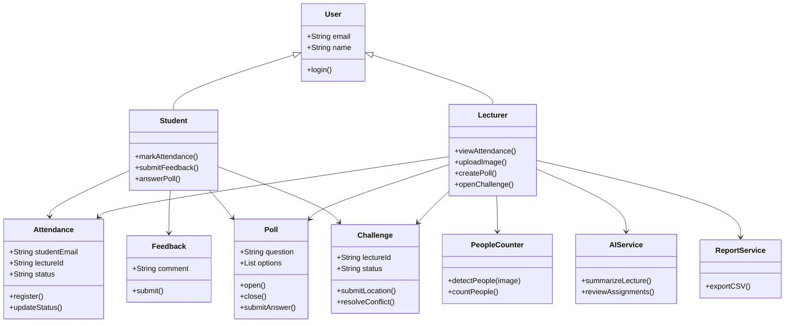
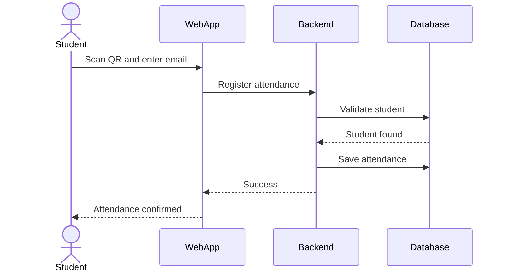
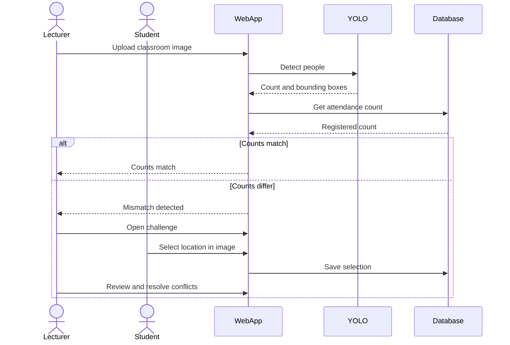
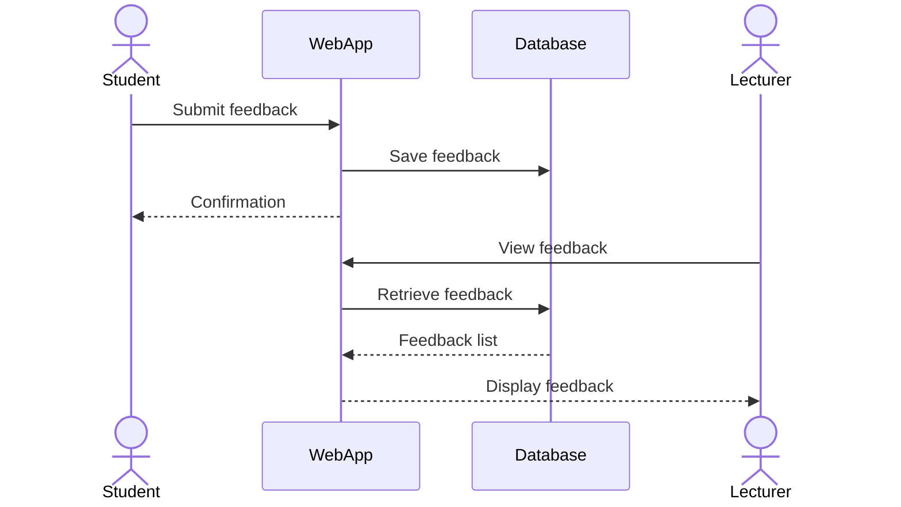
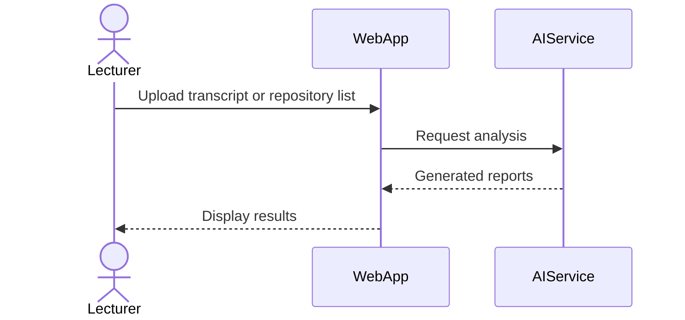

# UML Diagrams – Smart Classroom

## 1. Class Diagram

## 2. Sequence Diagram – Attendance Registration

## 3. Sequence Diagram – People Counting and Challenge

## 4. Sequence Diagram – Student Feedback

## 5. Sequence Diagram – AI Analysis

## 6. Design Summary

The diagrams describe the proposed system architecture and interactions between the main software components. They represent the planned system rather than only the initial prototype.
