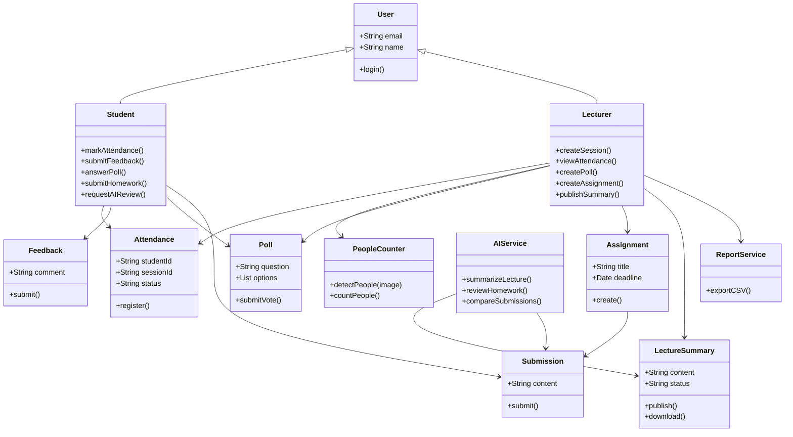
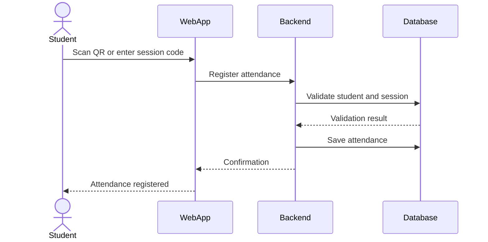
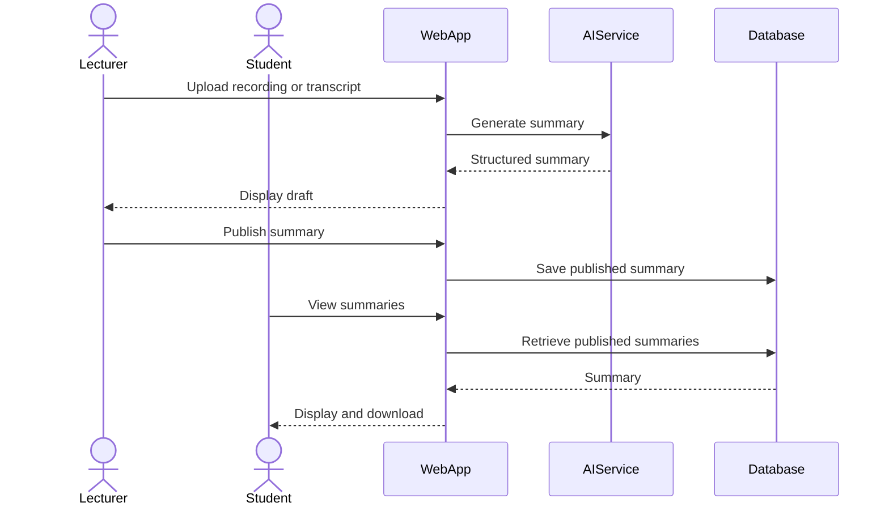
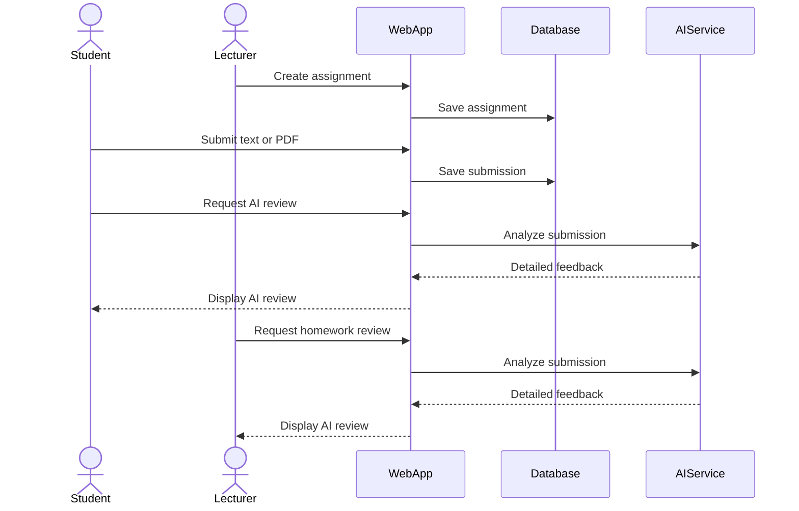

# UML Diagrams – Smart Classroom

## 1. Class Diagram

## 2. Sequence Diagram – Attendance

## 3. Sequence Diagram – AI Lecture Summary

## 4. Sequence Diagram – AI Homework Review

## 5. Design Summary

These diagrams describe the main components and interactions of the Smart Classroom prototype. They are simplified design models rather than an exact representation of the generated source code.
